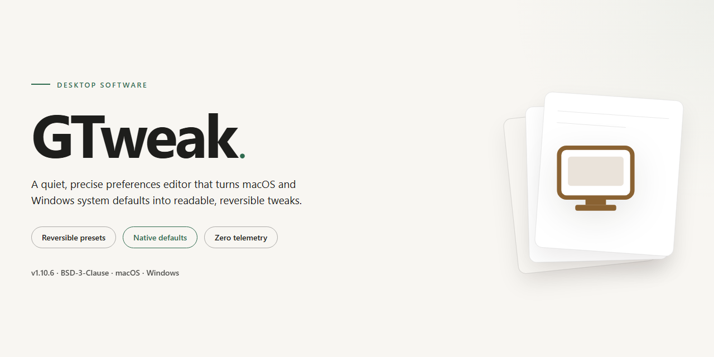

# 🛠 GTweak: Portable Windows Setup & Configuration Tool for Windows 10 & 11

### 🔌 PowerShell Setup Button

     

---

GTweak is a portable desktop utility for configuring and optimizing Windows 10 and 11 installations without requiring system-level deployment. Built on the .NET Framework 4.8 WPF stack, it exposes granular controls over activation state, security components, update behavior, background services, privacy and telemetry settings, network protocols, and preinstalled bloatware through a unified interface. The tool supports deep system maintenance tasks including component monitoring, NTFS compression management, and execution of custom scripts with elevated privileges. All configuration changes are applied directly through the native Windows APIs and registry, allowing the executable to operate from removable media while remaining independent of any installer.

## ✅ Before You Start

- Windows 10 or Windows 11
- PowerShell 5.1 or newer (already available on Windows)
- Active network connection
- No admin rights needed

## Features

GTweak provides a comprehensive set of system tweaks organized into functional categories, each targeting a specific area of Windows configuration and maintenance.

**Activation & Licensing**
- Activates Windows through HWID and KMS methods, applied directly from the utility.

**Security & Defender**
- Disables Windows Defender, SmartScreen, Antimalware, Virtualization-Based Security, and User Account Control.

**Updates & Services**
- Disables or pauses Windows updates and clears temporary update files.
- Disables unused and unnecessary system services.

**Privacy & Telemetry**
- Disables keyloggers and telemetry across Windows, NVIDIA, and Intel components.
- Disables services, event logging, and Task Scheduler tasks tied to data collection.
- Blocks Microsoft shadow domains through hosts file and firewall rules.

**Network & Diagnostics**
- Disables unnecessary network protocols including Teredo, ISATAP, and IPv6.
- Disables built-in diagnostic tools and disk defragmentation.

**Bloatware & AI**
- Uninstalls OneDrive and Microsoft Edge with all associated data and WebView2.
- Removes standard pre-installed UWP applications on Windows 10 and 11.
- Removes and disables AI assistants including Cortana, Copilot, and Recall.

**Interface & Notifications**
- Customizes themes, window behavior, taskbar layout, and system icons.
- Disables personalized ads, system banners, SCOOBE, notifications, and tips.

**Hardware & Performance**
- Configures keyboard and mouse behavior, including key filtering, sticky keys, and pointer acceleration.
- Applies the ultimate performance power plan.
- Resolves Realtek High Definition Audio sound delay through power settings adjustments.

**Maintenance & Advanced**
- Clears RAM, temporary files, and icon caches.
- Compresses and decompresses files using NTFS to reclaim disk space.
- Displays hardware configuration and monitors system components.
- Executes custom scripts (`.ps1`, `.cmd`, `.bat`, `.reg`) with TrustedInstaller privileges.

The application is portable and requires no installation, allowing it to run directly from removable media. All operations are exposed through a structured interface that surfaces each tweak as an independently selectable action, enabling granular control over the applied configuration.

## How it works

GTweak operates as a single portable executable that requires no installation, background service, or persistent agent. On launch, it enumerates the current Windows configuration and presents each tweak as an isolated, independently toggleable module. Configuration changes are applied through the native Windows APIs exposed to the process — registry operations, service control, scheduled task manipulation, firewall rules, and package management — rather than through scripted wrappers, so each action executes against the live system state and reports its result immediately.

All modifications are resolved at the level of individual settings. The application reads the existing value of a target key, service, or policy before writing, allowing it to detect whether a tweak is already active and to avoid redundant or conflicting writes. Because the tool runs elevated, it can reach protected areas such as TrustedInstaller-owned registry hives and system-level services that standard user context cannot modify.

The interface is organized by functional domain, with each panel grouping related controls so that activation, privacy, network, bloat removal, and performance adjustments remain independent of one another. Selections are staged in the UI and committed on demand, which lets you review the full set of pending changes before any of them touch the system. A built-in logging layer records every operation performed during a session, giving a traceable record of what was altered and when.

Hardware inspection and monitoring run alongside the tweaking engine, reading component data directly from the system to populate configuration and status views without external dependencies. Custom script execution is handled through the same privilege model, allowing `.ps1`, `.cmd`, `.bat`, and `.reg` files to run in an elevated context when a task requires capabilities beyond the built-in modules.

Because GTweak is portable, it leaves no installer footprint and can be moved between machines on removable media. Settings persist in the operating system itself rather than in the application, so the effects of any tweak remain in place after the tool is closed or removed.

## Compatibility

GTweak is designed for 64-bit Windows 10 and Windows 11 systems and operates as a portable executable without requiring installation or a persistent background service. The supported baseline is Windows 10 build 18362.116 (version 1903) and later, with full functionality validated on current Windows 11 releases. Both Home and Pro editions are supported; domain-joined and enterprise-managed environments may restrict certain tweaks through Group Policy, in which case the affected options are either unavailable or silently overridden by policy enforcement.

The tool requires the .NET Framework 4.8 runtime, which is present by default on Windows 10 1903 and later and on all Windows 11 builds. Elevated privileges are mandatory: GTweak must be launched with administrator rights to modify registry hives, service states, scheduled tasks, firewall rules, and protected system components. Standard user sessions will start the interface but cannot apply system-level changes.

Compatibility extends across the following areas:

- **Architecture:** x64 systems only. ARM64 devices are not supported.
- **Windows images:** official, unmodified installation media. Trimmed, slipstreamed, or custom-built images may lack required components, services, or registry keys, and behavior on such systems is not guaranteed.
- **Antivirus and security software:** third-party security suites and Windows Defender may flag portable binaries that modify system settings. Adding the executable to exclusions is recommended to prevent interference during operation.
- **Feature scope:** tweaks targeting Windows components such as Microsoft Edge, OneDrive, Cortana, Copilot, and Recall depend on the presence of those components in the installed build. Options for absent components are disabled or produce no effect.
- **Privilege-dependent operations:** script execution with TrustedInstaller privileges and low-level service manipulation require the process to run under an account with full administrative control; restricted tokens or mandatory integrity policies will block these operations.

GTweak does not install drivers, kernel-mode components, or persistent services, so it leaves no runtime footprint after exit. All modifications are applied directly to system configuration and persist independently of the tool. Compatibility with future Windows feature updates is maintained on a best-effort basis; major OS revisions may alter the underlying configuration surfaces and affect individual tweaks until the tool is updated accordingly.

## FAQ

**Is GTweak truly portable?**
Yes. GTweak is distributed as a single self-contained executable and does not require a traditional installation process. It does not register system services, write persistent entries to the startup sequence, or create uninstaller artifacts. Configuration state is held in local files adjacent to the executable, allowing the tool to be moved between machines on removable media without leaving a footprint beyond the changes you explicitly apply.

**Which Windows versions and builds are supported?**
GTweak targets Windows 10 and Windows 11, beginning with build 18362.116. The utility requires the .NET Framework 4.8 runtime to be present on the host system. Both x86 and x64 architectures are supported. Older builds and unsupported editions are outside the tested compatibility matrix and may exhibit partial functionality.

**Does GTweak require administrator privileges?**
Yes. Most tweaks modify protected registry hives, system services, scheduled tasks, and firewall rules, all of which require elevation. GTweak requests administrator rights at launch. Certain advanced operations, such as executing custom scripts with TrustedInstaller privileges, depend on this elevation to function correctly.

**Will my antivirus flag GTweak?**
Heuristic and behavior-based engines may flag GTweak because it performs legitimate but sensitive operations: disabling security components, editing protected registry keys, and modifying service states. These are intentional features, not indicators of compromise. Add the executable to your antivirus exclusions or temporarily disable real-time protection before running the tool. Always verify you obtained GTweak from an official distribution channel.

**What happens if I apply a tweak and want to revert it?**
GTweak exposes toggles for reversible settings, and reverting a toggle restores the prior state wherever a safe restoration path exists. Some operations are inherently destructive and are flagged as such in the interface—for example, uninstalling Microsoft Edge, removing OneDrive, or deleting pre-installed UWP applications. Create a system restore point before applying irreversible changes, and review each confirmation prompt carefully.

**Can I use GTweak on a modified or trimmed Windows image?**
GTweak is engineered and tested exclusively against official Windows images from trusted sources. Trimmed, customized, or otherwise altered distributions may have missing components, disabled services, or rewritten registry defaults that conflict with GTweak's operations. Functionality on such systems is unsupported, and you assume full responsibility for any resulting instability.

**Does GTweak collect telemetry or phone home?**
No. GTweak operates entirely offline and does not transmit usage data, hardware identifiers, or configuration details to any remote endpoint. All processing occurs locally on the host machine.

**How do I run custom scripts, and what privileges do they receive?**
GTweak accepts `.ps1`, `.cmd`, `.bat`, and `.reg` files through its script execution interface. Scripts can be launched with standard administrator rights or elevated to TrustedInstaller privileges for operations that require the highest trust level. Exercise caution: scripts execute with the same authority you grant them, and GTweak does not sandbox their behavior.

**Why do some interface strings appear in English after a language update?**
Localization coverage can lag behind feature development. When a newly added feature lacks a translated string, GTweak falls back to English for those elements by default. Translations are community-maintained, and updated language files are incorporated as they become available.

**Does GTweak modify the Windows activation state permanently?**
Activation-related tweaks apply HWID or KMS methods that persist according to the underlying mechanism. These operations are provided for legitimate licensing scenarios, and you are responsible for ensuring compliance with applicable licensing terms. GTweak does not circumvent activation for unlicensed use.

## Disclaimer

GTweak is provided as a portable, feature-driven utility for advanced Windows configuration. It exposes direct control over system-level components, including registry entries, service states, scheduled tasks, firewall rules, and file system attributes. Because these operations modify core operating system behavior, the tool requires elevated administrative privileges and is intended for users who understand the implications of each tweak.

The software is supplied "as is," without warranty of any kind, express or implied, including but not limited to the warranties of merchantability, fitness for a particular purpose, and non-infringement. The authors and contributors accept no liability for any direct, indirect, incidental, special, consequential, or punitive damages arising from the use, misuse, or inability to use this software, including but not limited to system instability, data loss, corrupted configurations, disabled security components, or voided warranties.

GTweak is designed exclusively for official, unmodified Windows images obtained from trusted sources. Modified, trimmed, or otherwise altered Windows distributions are not supported, and any resulting behavior is the sole responsibility of the user. Certain features intentionally disable or circumvent built-in security mechanisms, including Windows Defender, SmartScreen, antimalware components, VBS, and UAC. Disabling these protections may expose the system to elevated risk and should be performed only with full awareness of the consequences.

All tweaks are applied at the user's discretion. No changes are performed silently, and the user retains full responsibility for reviewing, selecting, and executing any operation offered by the interface. It is strongly recommended that a complete system backup or restore point be created prior to applying any modifications, and that affected systems be validated in a controlled environment before deployment.

Use of GTweak constitutes acknowledgment and acceptance of these terms.

## License

GTweak is distributed under the BSD 3-Clause License, a permissive open-source license that grants broad freedom to use, modify, and redistribute the software while imposing minimal restrictions on downstream projects.

Under the terms of this license, you are permitted to:

- Use GTweak in source or binary form for any purpose, including commercial applications.
- Modify the source code and integrate it into your own projects or derivative works.
- Redistribute original or modified copies, provided the license terms are upheld.

Redistribution obligations require that the following conditions be preserved:

- The copyright notice, the list of conditions, and the disclaimer must be retained in all source code redistributions.
- Binary redistributions must reproduce the same notice, conditions, and disclaimer in the accompanying documentation or materials.
- Neither the name of the author nor the names of any contributors may be used to endorse or promote products derived from this software without prior written permission.

The software is provided "as is," without warranty of any kind, express or implied, including but not limited to warranties of merchantability, fitness for a particular purpose, and non-infringement. In no event shall the authors or copyright holders be liable for any claim, damages, or other liability arising from, out of, or in connection with the software or its use.

Because GTweak performs system-level modifications—including registry edits, service configuration, and script execution with elevated privileges—users are expected to review the license terms in full before deploying, modifying, or redistributing the tool in any environment. Full license text is included with the distributed source.